<p align="center">
  
</p>

<h1 align="center">Piko</h1>

<p align="center">
  <b>A minimal, fast, search-first Android launcher.</b><br>
  ~80&nbsp;KB · zero dependencies · no ads · no tracking · open source
</p>

<p align="center">
  <a href="https://github.com/mkalmousli/Piko/releases/latest"></a>
  <a href="https://github.com/mkalmousli/Piko/actions/workflows/ci.yml"></a>
  <a href="LICENSE"></a>
  
  <a href="https://al-mo.de/apps/piko/"></a>
</p>

<p align="center">
  <a href="https://github.com/mkalmousli/Piko/releases/latest"><b>⬇ Download the APK</b></a> ·
  <a href="https://al-mo.de/apps/piko/">Website</a> ·
  <a href="PRIVACY.md">Privacy</a> ·
  <a href="https://al-mo.de">Author</a>
</p>

<p align="center">
  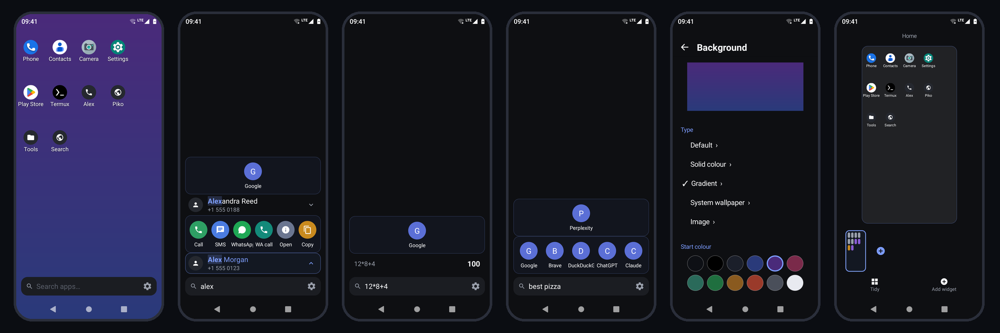
</p>

Piko opens on a search bar. Type a few letters and launch an app, call a contact, do the maths,
convert a currency or hand the query to your favourite search engine or AI chat. Swipe once to
reach a clean, configurable icon grid. That's it.

## Features

**Search-first home**
- Opens straight into search; remembers which result you pick for a query and ranks launch frequency, so results improve with use.
- Multi-word matching with highlighted matches; search by custom **tags** (e.g. `photos` finds your camera).
- **Hidden apps**: keep apps out of results without uninstalling them; the picker has a live filter.
- **Icon packs**: choose any installed ADW/Nova/Apex icon pack.
- **Permissions screen** that explains each permission and lets you grant it. Nothing is required.
- **Phone numbers**: typing digits matches contacts by number and offers call/message for numbers not in your address book.

**Instant answers**
- Scientific calculator: `2(3+4)^2`, `sqrt(16)+3!`, `sin(30deg)`, `50% of 200`, `10 mod 3`, `log2(8)`, constants `pi`/`e`.
- **Calculator** inline: `12*8+4` → `100`; any number you type gets a calculator row.
- **Currency conversion** inline: `100 usd to eur` (live ECB rates via [Frankfurter](https://www.frankfurter.app)).

**Home screen**
- Long-press an icon to lift it, then drag: a highlighted drop target shows where it lands, occupied cells swap, drag to the top strip to remove, or release without moving for the item menu.
- Hold an icon at a screen edge to carry it to the next page (a new page is created past the last one).
- **Free-form placement**: icons and widgets sit exactly where you drop them (switch to snap-to-grid in Settings).
- Long-press empty space to **zoom out** into page overview: add, delete, reorder pages, tidy a page onto the grid, or add apps/widgets.
- Drag an icon to the bar at the top to remove, uninstall, open app info, edit, or toggle its name.
- Hide app names globally or per app.
- 3D page swing between pages, rubber-band overscroll and haptic feedback.

**Web & AI in one tap**
- One result row per engine: Google, Brave, DuckDuckGo, Bing, ChatGPT, Claude, Perplexity.
- Enable, reorder, or add your **own engine or AI chat** from any URL with a query parameter.

**Contacts**
- Search contacts by name or **by phone number**.
- Every contact action (**Call, SMS, WhatsApp message, WhatsApp call**, open, copy) is its own result row; each can be switched off.
- Choose what tapping a result does; copy numbers; optional direct-call mode that skips the dialer.
- Contacts are optional: decline the permission and everything else still works.

**Home screen**
- Configurable grid (columns × rows) and number of pages.
- Long-press menu: app info, **rename / tags / custom icon**, uninstall, remove from home.
- Add apps and **widgets** (with resize handles) from the ⋮ menu.
- Quick-contact shortcuts.

**Small & private**
- Pure Android SDK: no AndroidX, no Material, no analytics, no ad or crash-reporting SDKs.
- The only network use is the currency lookup and opening web searches you trigger.

## Screenshots

All captured on a **Moto G7 Play** (720×1512).

| Home | Long-press menu | Add menu |
|---|---|---|
| 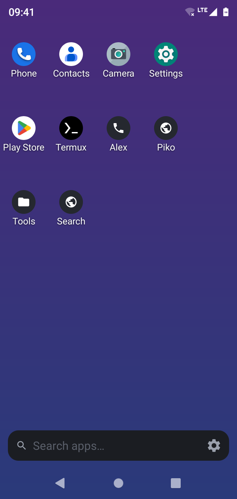 | 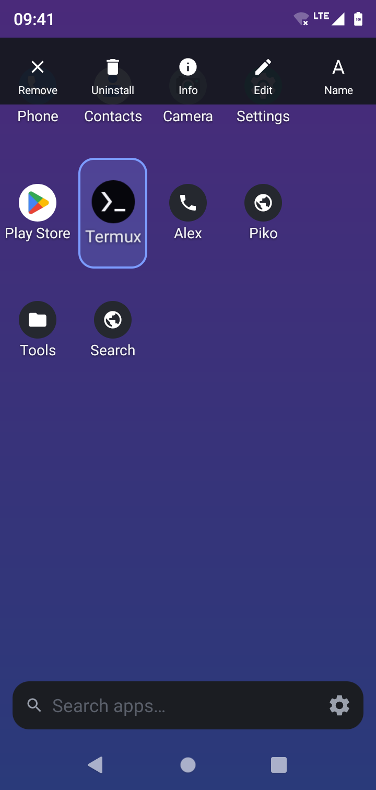 | 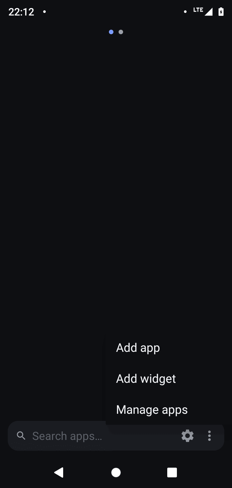 |

| App search | Calculator | Currency |
|---|---|---|
| 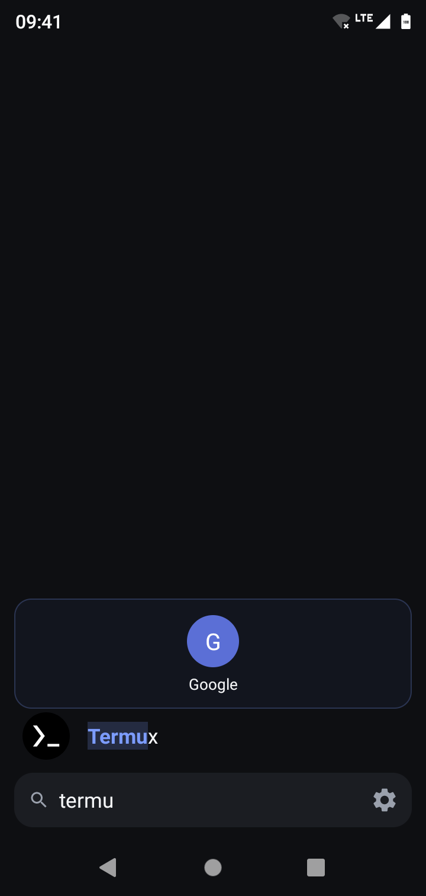 | 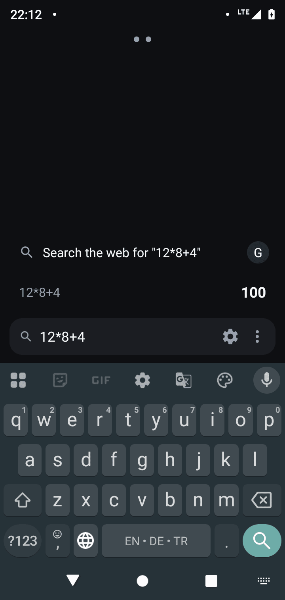 | 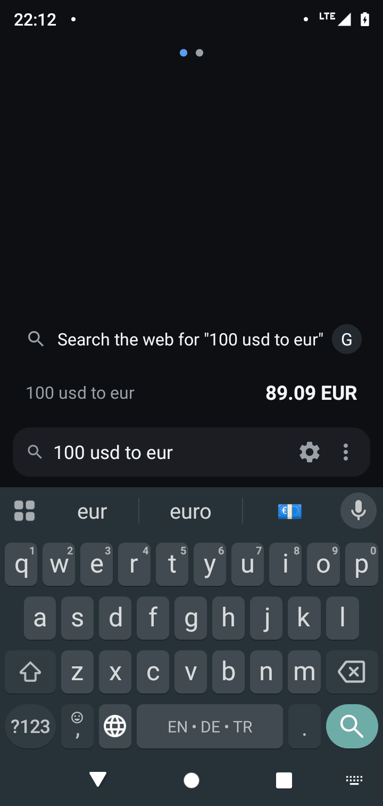 |

| Web &amp; AI search | Settings | Search sources |
|---|---|---|
| 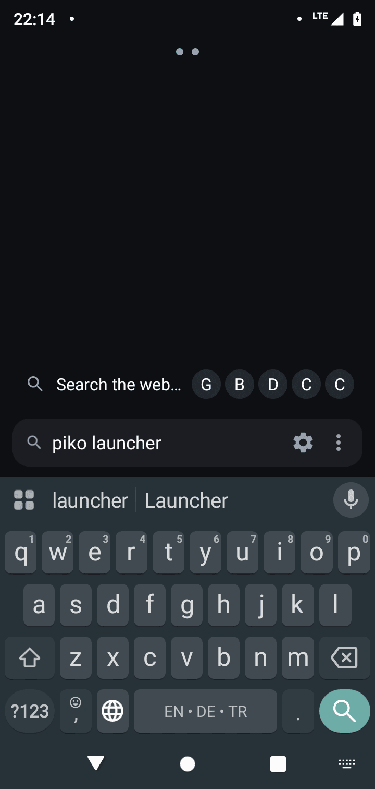 | 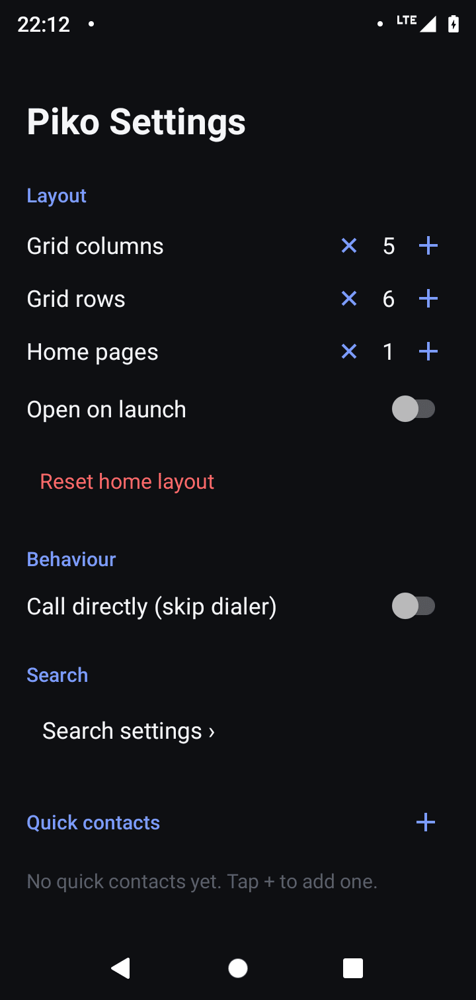 | 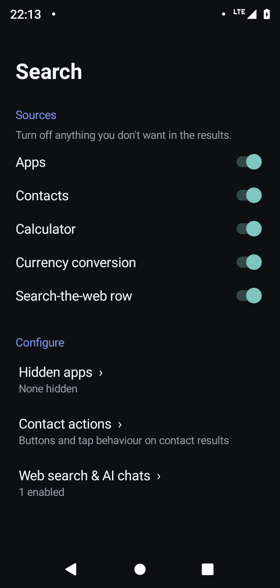 |

| Engines &amp; AI chats | Contact actions | Hidden apps |
|---|---|---|
| 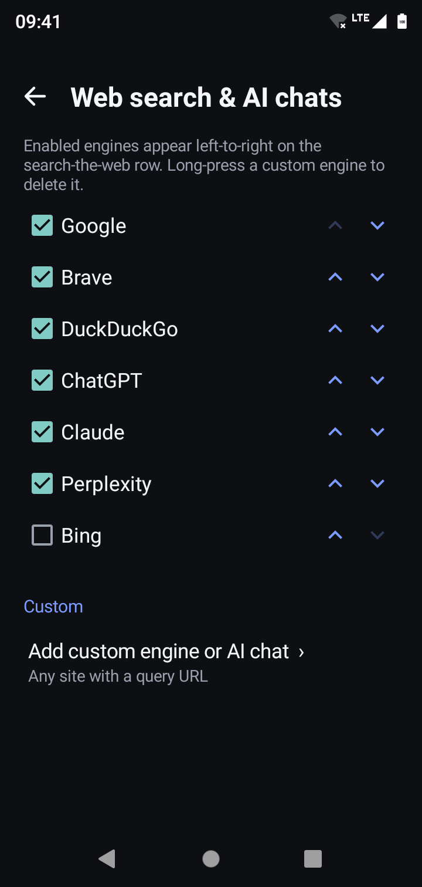 | 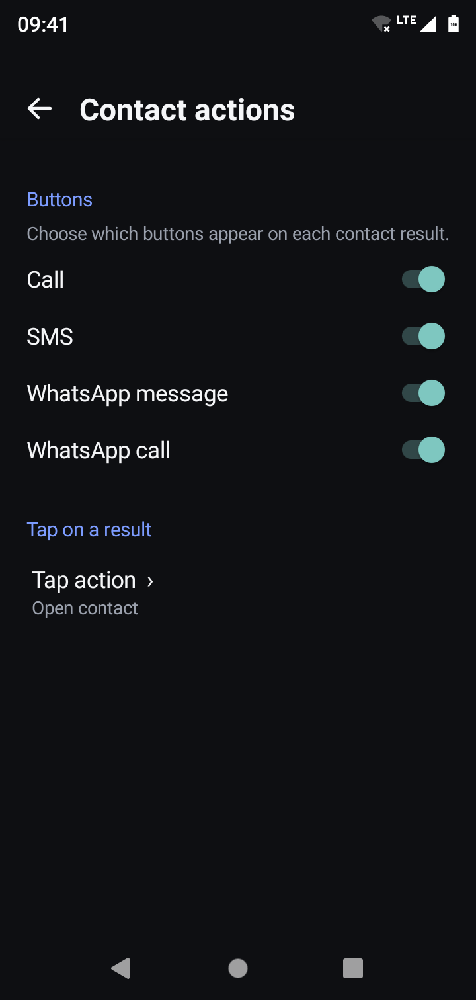 | 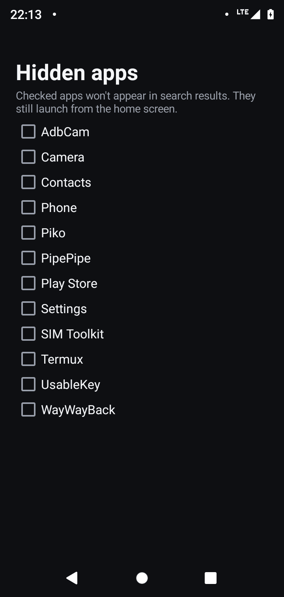 |

## Install

1. Download `Piko-<version>.apk` from the [latest release](https://github.com/mkalmousli/Piko/releases/latest).
2. Open it and allow installs from your browser/file manager if asked.
3. Press Home and choose **Piko → Always**.

Requires Android 8.0 (API 26) or newer. Releases include a SHA-256 checksum.

## Permissions

| Permission | Why |
|---|---|
| `READ_CONTACTS` | Contact search and quick contacts (optional) |
| `CALL_PHONE` | Direct-call mode (optional, falls back to the dialer) |
| `INTERNET` | Currency rates and opening web searches |
| `REQUEST_DELETE_PACKAGES` | Uninstall action in the long-press menu |

See [PRIVACY.md](PRIVACY.md).

## Build from source

Requires JDK 17 and the Android SDK (API 34).

```bash
git clone https://github.com/mkalmousli/Piko.git
cd Piko
./gradlew assembleDebug      # app/build/outputs/apk/debug/app-debug.apk
./gradlew assembleRelease    # minified; signed if PIKO_KEYSTORE_* env vars are set
```

## Releases

Pushing a tag like `v1.0.0` triggers [the release workflow](.github/workflows/release.yml): it builds a
signed APK, attaches it with a checksum and generates release notes. Pushes and pull requests run
[CI](.github/workflows/ci.yml). The [project site](https://al-mo.de/apps/piko/) is deployed from
[`docs/`](docs) by [the Pages workflow](.github/workflows/pages.yml).

## Contributing

Issues and pull requests are welcome — see [CONTRIBUTING.md](CONTRIBUTING.md).

## Author

Made by **[Mohamad Almousli](https://al-mo.de)** · [al-mo.de](https://al-mo.de) · [@mkalmousli](https://github.com/mkalmousli)

## License

[MIT](LICENSE) © 2026 Mohamad Almousli
